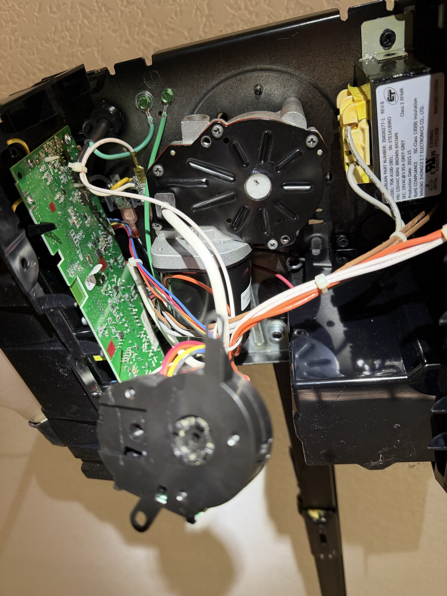
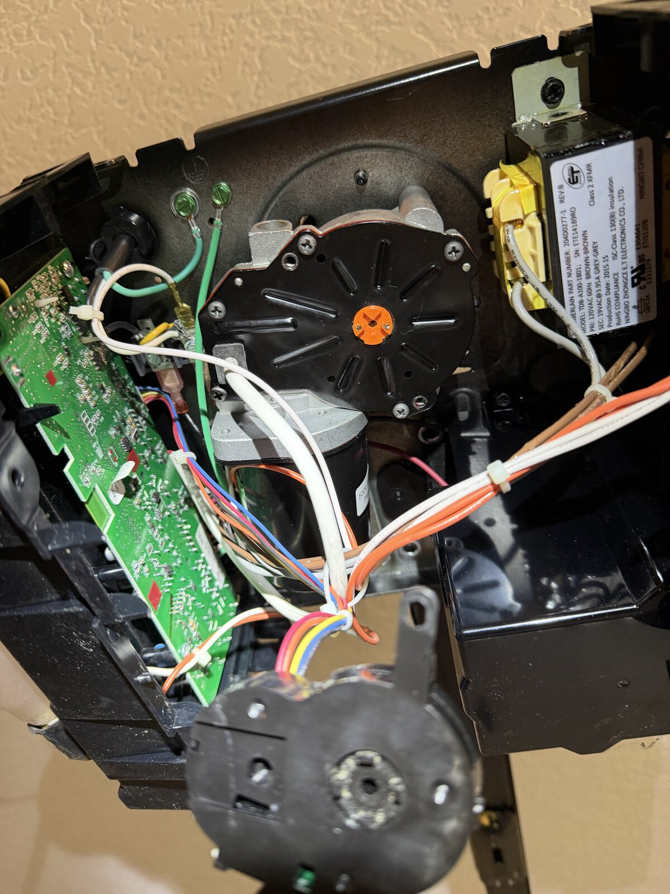

# LiftMaster 8550W Travel Module Motor Coupler (3D-Printable Fix for Error 1-5)

We have a Chamberlain garage door opener that started throwing an error: motor control 1-5. The travel buttons (the up and down arrow buttons for setting limits) were blinking once on the up button, then five times on the down button.

The model is an 8550W-267, technically from LiftMaster. The FCC ID is HBW1D8169-1, and the part number is 001D8363.

This repo is the part I designed to fix it, so hopefully it helps someone else.

## The problem

- With the door disconnected, it moved freely just fine.
- The opener would move a few inches, then stop and reverse back.
- Tracks and rollers were clear, and the spring is relatively new and in good condition.
- I unplugged it for 10 minutes and tried setting the travel too. Holding up stopped it after a couple of seconds, and holding it again would only let it move about 6 inches at a time.

## What was actually wrong

I took off the travel module and could see the issue. It's not the gear on the travel module that's broken, it's the gear on the motor. The white plastic gear was broken, and the teeth were stripped off.

That gear only spins the travel module (the sensor that tells the opener the motor is turning). With it stripped, the motor runs, but the opener can't tell, so it shuts off after a few inches and throws 1-5.

As far as I could find, LiftMaster doesn't sell that gear by itself. The official fix is the whole motor and travel module kit (041-0236-000), which is around $300, close to the price of a new opener. So I designed a replacement.

## The part

It's a small disc that screws onto the end of the motor. Four slots on top take the four lugs on the travel module. A center screw holds it down, and two pins keep it from spinning.

 

| File | Description |
|---|---|
| [`motor_coupler_short.scad`](motor_coupler_short.scad) | Parametric OpenSCAD source (4 mm tall, with anti-spin pin holes). Tweak it for your unit. |
| [`motor_coupler_short_pins.stl`](motor_coupler_short_pins.stl) | Ready-to-slice STL exported from the SCAD file. |
| [`motor_coupler_short_pins_0.15mm_PETG_MK3S_8m.gcode`](motor_coupler_short_pins_0.15mm_PETG_MK3S_8m.gcode) | The G-code I printed. **Prusa MK3S, 0.4 mm nozzle, PETG only.** For anything else, slice the STL yourself. |

### Dimensions (as designed)

- Outside diameter: 14.5 mm
- Height: 4 mm
- Slots: 3.7 mm wide, to fit the travel module's 3 mm lugs
- Center hole for an M3 screw, with a 6.2 mm recess so the screw head sits level with the slot floor
- Two 2 mm pin holes, 5 mm from center, under the solid sections between the slots

The first version was a tight fit, so I opened up the spacing between the slots and reduced the diameter by half a millimeter. After that, it fit perfectly.

## Printing

- Material: PETG or nylon (PLA can soften in a hot garage)
- 100% infill
- Print slot side up
- If the fit is off, adjust `slot_clear` in the file (higher = looser)

To make an STL: open the `.scad` file in [OpenSCAD](https://openscad.org/) (free), change any values you need, press F6 to render, then export the STL.

## Installing

**Unplug the opener and remove the battery backup before working on it.**

1. Remove the light lens and cover, then remove the travel module.
2. Remove what's left of the broken gear and clean out any bits of stripped plastic.
3. Screw the new coupler onto the end of the motor with an M3 screw and blue threadlocker.

### It spins loose: add pins

My first install spun loose with just the screw, because the motor runs both directions. So I added a pin on each side, under the gears for strength.

1. With the coupler screwed on, use the pin holes as a drill guide and drill about 4 mm deep. **Make sure the pins go into the part that rotates with the motor, not the stationary motor housing,** or you'll lock up the motor.
2. Use 8 mm long pins. 2 mm or 5/64" dowel pins or roll pins, the cut shank of a 5/64" drill bit, or a 14-gauge wire nail all work.
3. Glue the pins in with epoxy (I used J-B Weld). Make sure they don't stick up above the top of the coupler.
4. Let the epoxy fully cure before running the opener.

## After installing

1. Put the travel module back on and plug its harness in firmly.
2. Reinstall the battery and cover.
3. Reset the up and down travel limits.
4. Run the door several times and make sure it stops in the same place every time.
5. **Do the safety reverse test:** lay a 2x4 flat under the door and make sure the door reverses when it touches it. Also check that the safety sensors (photo eyes) stop the door.

Check the coupler after a couple of weeks for wear or play. It's cheap to print another one.

## Disclaimer

This is a DIY repair that worked for me. Garage doors are heavy and can cause serious injury. Use this at your own risk, always do the safety reverse test after any repair, and call a garage door technician if you're not comfortable doing this.

Everything in this repo is provided "as is", without warranty of any kind. The author is not liable for any injury, damage, or loss from its use. Not affiliated with or endorsed by The Chamberlain Group, LiftMaster, or Prusa Research; trademarks belong to their owners.

## License

Copyright (c) 2026 Justin Cooper. Licensed under [Creative Commons Attribution 4.0 International (CC BY 4.0)](https://creativecommons.org/licenses/by/4.0/). See [LICENSE](LICENSE).
